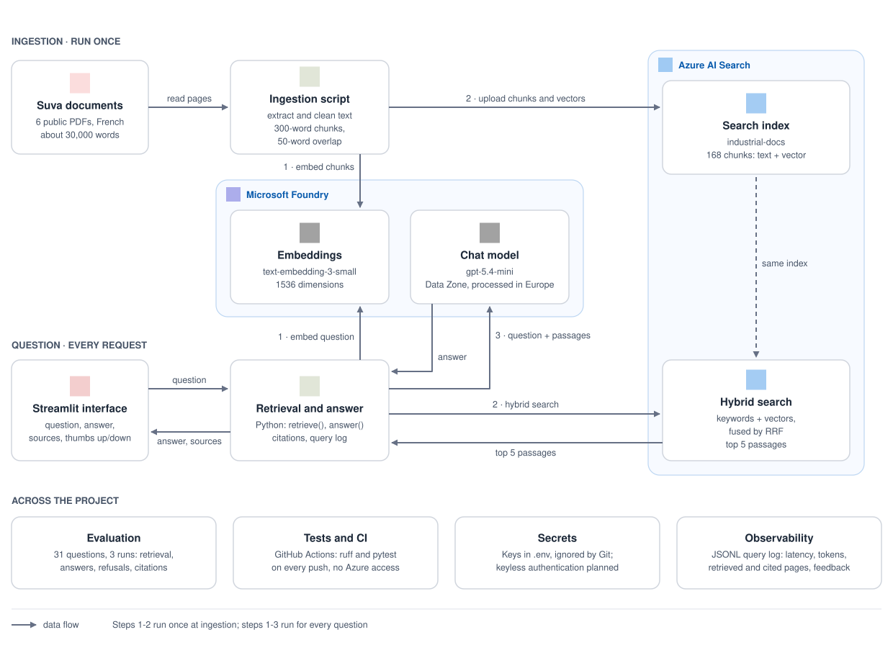
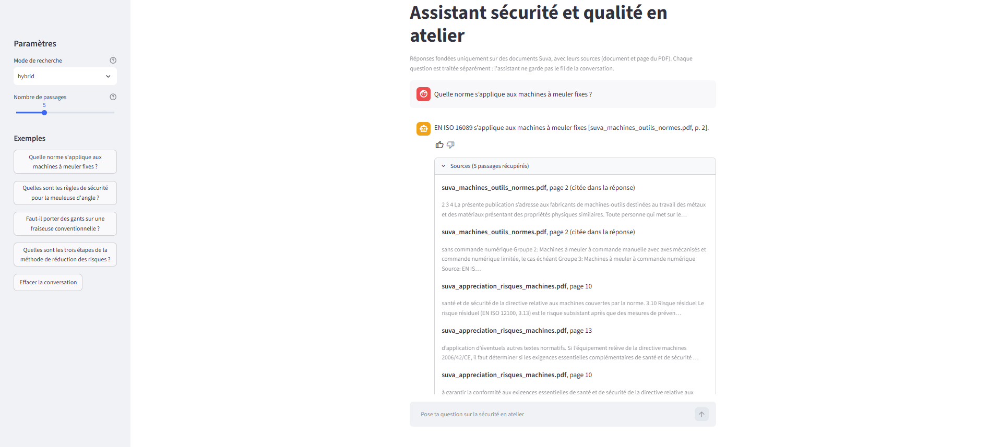
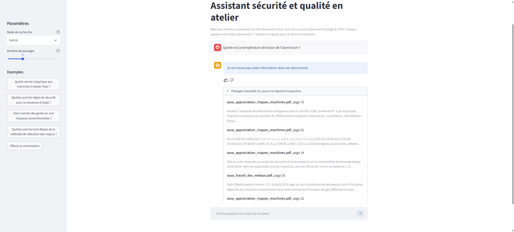

# industrial-doc-assistant

[](https://github.com/sami-beniaouf/industrial-doc-assistant/actions/workflows/ci.yml)

A retrieval-augmented generation (RAG) assistant for workshop safety. It answers questions in French using only a corpus of public Suva documents (machine-tool safety, metalworking) and cites its sources as document and page. If the documents do not contain the answer, it says so.

> **Status:** functional prototype. Ingestion, hybrid retrieval, answer generation with citations, an evaluation, a Streamlit interface and a CI workflow are in place.

## Architecture



## Demo



*A question answered from the documents, with citations (document and page) and the retrieved passages listed under the answer.*



*A question outside the documents: the assistant refuses instead of answering from general knowledge.*

## Stack

- Python, `pypdf`, `openai`, `azure-search-documents`
- Azure OpenAI via Microsoft Foundry: `text-embedding-3-small` (1536 dimensions), `gpt-5.4-mini`
- Azure AI Search: French analyzer for keywords, HNSW index for vectors, hybrid ranking (RRF)
- Streamlit for the web interface

## Getting started

Requires Python 3.10+, an Azure OpenAI resource with an embedding and a chat deployment, and an Azure AI Search service.

```powershell
python -m venv .venv
.\.venv\Scripts\Activate.ps1          # Linux/macOS: source .venv/bin/activate
pip install -r requirements.txt
copy .env.example .env                 # fill in your Azure endpoints, keys and deployment names
```

Place the source PDFs in `data/raw/` (not versioned), then build the index and ask a question:

```powershell
python scripts/ingest.py
python scripts/ask.py "Quelle norme s'applique aux machines à meuler fixes ?"
streamlit run app/streamlit_app.py
```

The ingestion is idempotent: chunk IDs are deterministic, so re-running it updates documents instead of duplicating them. Secrets stay in `.env`, which is ignored by Git.

The Streamlit interface writes a query log (`logs/queries.jsonl`, not versioned): question, answer, retrieved and cited pages, tokens, latency, and thumbs up/down feedback.

### Checks

The same checks run in the CI, without any Azure access:

```powershell
pip install -r requirements-dev.txt
ruff check src tests scripts app
pytest
```

## Evaluation

The assistant is evaluated on 26 French questions (22 with an answer in the documents, 4 that must be refused) and 5 extra yes/no questions kept aside. The questions were drafted with an AI assistant and selected by the author; each expected page was checked automatically against the PDF text. Generation is not deterministic, so generation figures are means over 3 runs. Answers are graded by the chat model itself, and every failure was then read by hand. Questions, raw results and notes are in [`eval/`](eval/).

**Retrieval**: is an expected page among the top 5 passages? (22 answerable questions, ranges over two evaluations)

| Mode | In top 5 | First in rank | MRR |
|---|---|---|---|
| Hybrid (keywords + vectors) | 22/22 | 20–21/22 | 0.95–0.97 |
| Keywords only | 21–22/22 | 17–19/22 | 0.85–0.90 |
| Vectors only | 21/22 | 17/22 | 0.85 |

The top 5 does not separate the modes on this small corpus, and retrieval moved slightly between the two evaluations without any code change (the vector search is approximate), so small gaps are not conclusive. Hybrid had the best MRR both times.

**Generation** (hybrid mode, mean over 3 runs, before and after a prompt change)

| | Before | After |
|---|---|---|
| Correct answers (model judge) | 18.3 / 22 | 19.7 / 22 |
| False refusals | 1.0 / 22 | 0.0 / 22 |
| Correct refusals | 4 / 4 | 4 / 4 |
| Answers citing a page that was not retrieved | 0 | 1 of 66 (not investigated) |

Reading the failures by hand, the real score is closer to 20–21 / 22.

**What went wrong and what was done**

- **Wrong expected data.** Four entries (three expected answers and one list of expected pages) were inaccurate or asked for more than the question did. They were corrected after the first run, and the change is documented in `eval/README.md`.
- **Unstable judge.** The same answer was sometimes graded correct and sometimes not. Failures were therefore reviewed by hand, and results are given as ranges.
- **False refusals.** The assistant sometimes answered "I cannot find this information" on yes/no questions although the right page was ranked first (3 of 66 answers on the main set, 2 of 9 on the extra questions). The prompt was rewritten: answer Oui/Non first, treat explicit prohibitions and obligations as answers, and only rely on passages about the same machine. False refusals dropped to zero, and the two trap questions (a rule for under-18s on welding, a ladder in the rain) are still refused.
- **Overfitting risk.** Because the same questions guided the prompt, 5 new questions were added. I had seen their baseline failures before changing the prompt, so they are only partly independent.
- **Remaining failures.** "On which machines are gloves forbidden?" fails in every run because the lathe sheet (page 7) is never retrieved, not even with 8 passages instead of 5 (tested in the interface). That page opens with the end of the CNC sheet before the lathe sheet begins, which probably dilutes its match; chunking by machine sheet instead of by page is the likely fix and is not done yet. One answer in 66 contained a stray non-French word.

## Project structure

```
src/docassistant/   configuration, Azure clients, ingestion, search, answer generation, evaluation logic
scripts/            entry points (ingestion, ask, evaluate, connection checks)
app/                Streamlit interface
tests/              unit tests (chunking, chunk IDs, evaluation logic, query log)
.github/workflows/  CI: ruff and pytest
data/raw/           source PDFs (not versioned)
docs/               architecture diagram (generated by docs/diagrams/architecture.py), icons, screenshots
eval/               questions, results and notes
```

## Roadmap

- [x] Azure setup and connection checks
- [x] Ingestion pipeline (extraction, chunking, embeddings, index)
- [x] Hybrid retrieval and answer generation with citations
- [x] Evaluation (31 questions, repeated runs)
- [x] Streamlit interface
- [x] CI (ruff, pytest)

## Limitations

- Text extraction only: diagrams and images are not indexed.
- Fixed-size chunks that ignore document structure, so tables are extracted as flat text.
- Page citations use the PDF page index, which can differ from printed page numbers.
- Small evaluation set (31 questions), graded by the same model that answers.

## Towards production

This is a prototype. For a production system I would add:

- A larger, independent evaluation set (about 100 questions from real users, validated by a domain expert), with a part never used for tuning, and a judge model different from the answering model.
- Better retrieval: semantic reranking, chunking by section, filtering by machine, a larger number of passages for list questions.
- Automatic checking that each statement is supported by the cited passage.
- Keyless authentication (Entra ID and managed identity), and a retention policy and access control for the query log, which can contain personal data.
- CI that also runs the evaluation on each change and blocks a change that degrades the results (today it runs linting and tests only).

## License

MIT. The Suva documents remain the property of their authors.
